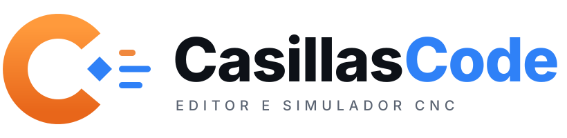

<p align="center"></p>

# Casillas Code

Editor e simulador de programas CNC (FANUC e Siemens, fresa e torno), com simulação 3D na web, no celular e no PC.
Faz parte da plataforma **Casillas CNC** (Code, Macro, Academy, Biblioteca CNC, Ferramentas e CAM).
O nome interno do código continua `CncStudio` (pastas, namespaces e solução).

> **Status (28/10/2026):** simulação 3D, Macro (geradores), Otimizador e Academy (módulo 1) na `main`; no desktop também o **CAM** (fresa, torno, 4º eixo, Trabalho), o **Casillas Assist** e o início do **CAM 3D** (STL e varredura). 1013 testes. **Nada do CAM foi testado em máquina real**: simule e rode a primeira vez no ar.
> Onde paramos: [docs/ESTADO.md](docs/ESTADO.md). Guia para agentes: [CLAUDE.md](CLAUDE.md) e [AGENTS.md](AGENTS.md).
> Plano e missões da plataforma ficam no repositório privado `casillas-plataforma`. Planos antigos: [docs/historico/](docs/historico/).

## O que a plataforma tem hoje

| Módulo | Onde | Situação |
|---|---|---|
| **Code** (editor e simulação 3D) | Web, celular e PC | Pronto |
| **Macro** (geradores de programa com prévia 3D, texto em gravação) | Web | Pronto; tela no desktop falta |
| **Otimizador** (laços Macro B só para simulador, com conferência) | Web | Pronto; desktop falta |
| **Academy** (aulas, exercícios, quizzes) | Web | Módulo 1; os demais a escrever |
| **CAM** | PC (Windows) | Fresa 2,5D e torno (rosca, canal, rebaixo), pós Fanuc e Siemens, banco de ferramentas, 4º eixo (face girada, texto no cilindro), tela **Trabalho** em árvore |
| **Casillas Assist** | PC | Bibliotecas (materiais, morsas, castanhas), orçamento com proposta, plano automático a partir do DXF |
| **CAM 3D** | PC | Abre STL e faz **varredura de acabamento** com fresa esférica; desbaste e STEP ainda não |
| **Ferramentas** (calculadoras) | Repositório `Casillas_app_2` | App à parte |

Limites que valem para o CAM: a simulação é de 3 eixos (grade de alturas; voxels na face girada) e **não promete colisão evitada**; o arquivo do SolidWorks (`.sldprt`) não é lido (exporte **STL**).

## Testar uma versão em andamento (prévia)

Cada ramo de trabalho (`fase-*`, `ajuste-*`, `dev`, `ext-*`) gera sozinho, a cada envio:

- **Web:** `https://<ramo>.casillas-code.pages.dev` (não é a versão oficial);
- **Windows:** em **Actions → Prévia → execução do ramo → Artifacts**, o arquivo `CasillasCode-teste-<ramo>`.

A versão oficial (web, painel de ativação e instalador) só é publicada pelo que entra na `main`.

## Versão oficial para Windows

A cada commit na `main`, o GitHub Actions compila, roda os testes e gera o executável para Windows:

1. No GitHub, abra a aba **Actions** → clique na execução mais recente com ✅.
2. Em **Artifacts**, baixe:
   - **CasillasCode-Setup** → instalador (atalho no menu Iniciar/área de trabalho e, se quiser,
     abrir .nc/.mpf/.spf com duplo clique); ou
   - **CasillasCode-win-x64** → versão portátil: extraia o .zip e rode **CasillasCode.exe**.
3. Se o Windows SmartScreen avisar (o programa não é assinado), clique em
   **Mais informações → Executar assim mesmo**.

As configurações ficam em `%APPDATA%\CncStudio\config.json` (valem para as duas formas).

O programa abre já com o `EXEMPLO.nc` carregado.

## Versão web (app instalável)

No ar em **https://casillas-code.pages.dev** — abre no navegador do PC ou do celular e pode ser instalada como app (botão "Instalar" ou menu do Chrome → Instalar app).

`src/CncStudio.Web` é a versão para navegador (PC e celular), com o mesmo Core. Fica fora da solução porque
precisa do workload de WebAssembly:

```bash
dotnet workload install wasm-tools
dotnet publish src/CncStudio.Web -c Release -o publish/web   # site estático em publish/web/wwwroot
```

O CI publica o resultado no ramo `ci-web` e, só a partir da `main`, no Cloudflare Pages (segredos `CLOUDFLARE_API_TOKEN` e `CLOUDFLARE_ACCOUNT_ID`).

## Compilar e rodar a partir do código (Windows 11)

1. Instale o **.NET 10 SDK**: https://dotnet.microsoft.com/download/dotnet/10.0
2. Na pasta do projeto:

```powershell
dotnet test                                # roda os testes do Core
dotnet run --project src/CncStudio.App     # abre o programa
```

Para testar desempenho com um arquivo grande (10 MB):

```powershell
.\tools\gerar-arquivo-grande.ps1           # cria GRANDE.nc na pasta atual
```

## Simulação 3D

- **Fresa e torno em 3D** com remoção de material, pelo mesmo Core na web (three.js) e no PC (OpenGL da placa de vídeo).
- **2D e 3D lado a lado** no PC; no celular, alterna pelo botão 3D.
- **Setup desenhado:** porta-ferramenta BT40 com porca ER, fresa e broca com cobertura, morsa, grampo e placa de 3 castanhas.
- **Torno:** peça por revolução com meia seção (vê o perfil e o furo por dentro).
- **Modo técnico:** corte pintado com a cor de cada ferramenta.
- **G00 no material** em vermelho, com lista que leva à linha e ao passo.
- **Voltar passo** sem refazer do bruto (até 16 pontos de retorno); bruto em bloco, redondo ou tubo.
- Girar (botão esquerdo ou um dedo), mover (botão direito ou dois dedos), zoom (roda ou pinça).
- No PC sem placa de vídeo compatível, a simulação volta ao desenho por CPU em 3 segundos.

## O que o editor faz

- **Tema claro/escuro:** botão ☀/☾ ao lado do dialeto (o backplot e a simulação ficam escuros, como uma tela de CAM).
- **Vários programas em abas:** Ctrl+N novo, Ctrl+Tab troca, Ctrl+W fecha (pergunta se quer salvar);
  cada aba guarda o próprio desfazer, cursor, dialeto e bruto. **Recentes ▾** lista os últimos 12 arquivos.
- **Editor:** highlighting Fanuc/Siemens, números de linha, Ctrl+O / Ctrl+S, dialeto pela extensão
  (com troca manual), análise automática 500 ms após digitar, painel de avisos/erros clicável.
- **Área gráfica única** (como no CIMCO): sólido iluminado com a trajetória por cima (G00 vermelho tracejado,
  G01 verde, G02 azul-claro, G03 azul-escuro), ferramenta com suporte; vistas fixas Isométrica, Topo, Frente e
  Lado na fresa; **Torno 3D** (peça por revolução com um quarto em corte e o inserto) e **Torno ZX** no torno.
  Opções Sólido / Trajetória / Ferramenta / Meia seção. Abre mostrando a peça pronta.
- **Execução linha a linha** (ou contínua) com **▶ Executar** e **⏸ Pausar** separados (espaço alterna),
  linha e passe anterior/próximo, régua para qualquer ponto, velocidade em linhas/s; painel de coordenadas
  (X/Y/Z — X em Ø no torno —, ferramenta, G-code, avanço, linha, passe, distância); aviso de G00 dentro do material.
- **Editor** colorido por movimento (faixa e fundo da linha: G00 vermelho, G01 verde, G02/G03 azul) e a linha
  em execução em amarelo; clique na trajetória vai à linha; **📏 Medir** encaixa nos pontos.
- **Busca e funções NC:** procurar/substituir em português (maiúsculas, palavra inteira, expressão regular),
  remover/inserir espaços, remover comentários e números de bloco, renumerar, maiúsculas.
- **Ajuda no editor:** pare o mouse sobre G71, CYCLE83, #3000, GOTOF... para ver o que é e os parâmetros.
- **Clique na trajetória** (backplot ou simulação) para ir à linha; **📏 Medir** no backplot (encaixa nos pontos).
- **Limites de curso** (Máquina → Limites de curso): avisa a linha em que o programa passa do curso.
- **Painel de avisos/erros** com filtro e contagem.
- **Bruto** (Máquina → Bruto…, ou na Simulação): automático, informado (bloco X/Y/Z na fresa, Ø × comprimento
  no torno) ou lido do cabeçalho "(BRUTO 100 X 80 X 20)"; guardado por arquivo, desenhado no backplot, usado na
  simulação (que avisa G00 removendo material) e na folha de setup.
- **Comparar** (Arquivo → Relatórios): programa do editor × outro arquivo, lado a lado, com linhas alteradas,
  incluídas e removidas em cores, navegação por diferença (F7) e opções de ignorar espaços, maiúsculas e números N.
- **Folha de setup** (Arquivo → Relatórios): informações do programa atual (arquivo, número, cabeçalho,
  comando, máquina, zeros, limites), lista de ferramentas com descrição, tempo por ferramenta e total, e o
  desenho da trajetória. Abre no navegador: Ctrl+P → Salvar como PDF.

## Estrutura

```
CncStudio.sln
src/CncStudio.Core/          Lógica pura, sem UI e sem pacotes NuGet
  Dialects/ Lexing/ Parsing/ Fanuc/Siemens, lexer e parser com diagnósticos em português
  Execution/ Trajectory/     Execução passo a passo e movimentos
  Simulation/                Remoção de material (fresa e torno) e fábrica da simulação
  Scene/                     O que o 3D desenha (malhas, câmera, cores), igual na web e no PC
  Setup/ Statistics/ Reports/ Editing/  Setup, estatísticas, relatórios e funções NC
  Cam/                       CAM: geometria 2D, DXF, operações de fresa e torno, pós, Job, 4º eixo
  Cam3D/                     CAM 3D: leitor de STL, malha, drop cutter e varredura de acabamento
  Assist/                    Bibliotecas, orçamento e plano automático
src/CncStudio.App/           Desktop Avalonia (editor, gráfico, 3D por OpenGL em Graphics/)
src/CncStudio.Web/           Web e celular (WebAssembly; 3D por three.js em wwwroot/scene3d.js)
tests/CncStudio.Core.Tests/  Testes xUnit do Core
samples/                     Exemplos Fanuc e Siemens (fresa, torno, macros, peças comentadas)
admin/                       Painel de ativação de licenças (publicado à parte)
supabase/                    Migrações e modelos do banco de licenças
installer/                   Script do instalador (Inno Setup)
tools/                       Fotos da interface (CI), ícone, página e arquivo grande de teste
docs/                        ESTADO.md, fichas de tarefas, Academy (glossário) e histórico
```

## G-code suportado

- **Movimento:** G00, G01, G02, G03 nos planos G17/G18/G19, por centro (I/J/K) ou raio (R no Fanuc, CR= no Siemens).
- **Modos:** G90/G91, G20/G21 (G70/G71 no Siemens), G54–G59 (G500 no Siemens), TRANS/ATRANS.
- **Furação:** G81, G82, G83 com G98/G99, Q e repetição K; CYCLE81, CYCLE82, CYCLE83, inclusive com MCALL.
- **Ferramentas:** T + M06; diâmetro por ferramenta em *Máquina → Ferramentas e zeros de peça*.
- **Sem desenho de movimento:** G04 (espera), G53 (coordenada de máquina), G28/G30.
- Números sem ponto no Fanuc (`X10`): 10 mm por padrão; configurável para 0,010 mm.

## Programação paramétrica

- **Fanuc (Macro B):** variáveis `#1`–`#999`, `#[...]`, contas e funções (SIN, COS, TAN, ATAN, SQRT,
  ABS, ROUND, FIX, FUP...), `IF [...] GOTO`, `IF [...] THEN`, `WHILE [...] DOn` / `ENDn`, `GOTO`,
  `M98 P.. L..`, `M99` (com `P`), `G65 P.. A.. B..` (argumentos em #1–#26), alarme `#3000`.
- **Siemens:** parâmetros `R`, `DEF`, `IF/ELSEIF/ELSE/ENDIF`, `WHILE`, `FOR`, `REPEAT/UNTIL`, `LOOP`,
  `GOTOF/GOTOB/GOTO`, rótulos, `REPEAT rótulo [rótulo] P=n`, `L10 P2`, chamada por nome, `IC()`/`AC()`, `MSG`.
- **Subprogramas:** no mesmo arquivo (O-number / `%_N_..._SPF`) ou na pasta do programa aberto
  (`O1234.nc`, `L10.SPF`, `FURO.SPF`...).
- **Cantos e compensação:** `,R` / `,C` (Fanuc) e G41/G42 com o diâmetro da tabela de ferramentas.
- **Proteção:** laço infinito e chamadas aninhadas demais interrompem a simulação com erro na linha.
- Exemplos em `samples/macros/`: ESPIRAL_WHILE.nc, SUBPROGRAMA.nc, CHAVETA.mpf, CHAMA_FURO.mpf + FURO.SPF.

## Estatísticas

- Aba **Estatísticas**: tempo total estimado, tempo de corte, de rápido e de espera, distâncias,
  movimentos e trocas de ferramenta; tabela por ferramenta (clique para ir à 1ª linha) e limites X/Y/Z.
- Tempo de corte = comprimento ÷ avanço (arcos pelo comprimento real); rápido pela velocidade de
  *Máquina → Ferramentas e zeros de peça → Programa* (padrão 10.000 mm/min). Sem aceleração.
- Esperas: `G04 X`/`G04 P` (Fanuc), `G4 F`/`G4 S` (Siemens), `G82 P`, DTB do CYCLE82/CYCLE83.

## Torno

- **Tipo de máquina:** *Automático* (detecta pelo programa: G71/G70/G76, U/W, G96, CYCLE95/97, DIAMON...), *Fresa* ou *Torno*,
  na caixa **Máquina** ao lado do dialeto. Programas de torno abrem o backplot na vista **Torno (ZX)**.
- **Coordenadas:** X em diâmetro (DIAMON/DIAMOF no Siemens), U/W incrementais (Fanuc), plano G18, ferramenta T0101.
- **Avanço e rotação:** G99/G98 (Fanuc) e G95/G94 (Siemens), G96/G97, limite G50 S / LIMS= / G26 S
  (padrão em *Máquina → Programa*). O avanço por rotação vira mm/min com a rotação no diâmetro do movimento.
- **Fanuc:** G71/G72 (desbaste, inclusive com rebaixo) + G70 (acabamento), G74/G75, G76 (rosca em passes), G90/G92/G94, G32.
- **Siemens:** CYCLE95 (contorno por subprograma `"KONTUR"` ou rótulos `"INICIO:FIM"`; VARI 1–12), CYCLE97, G33.
- **G71/G72 com rebaixo** (tipo II) e **G74/G75** (bicadas na face e canais em X).
- Exemplos: `samples/torno/EXEMPLO_TORNO.nc` e `EXEMPLO_TORNO.mpf` (botões *Torno Fanuc* / *Torno Siemens*).

## Licença

A definir (MIT provável).
